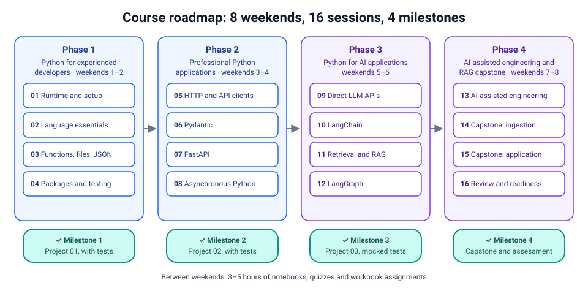
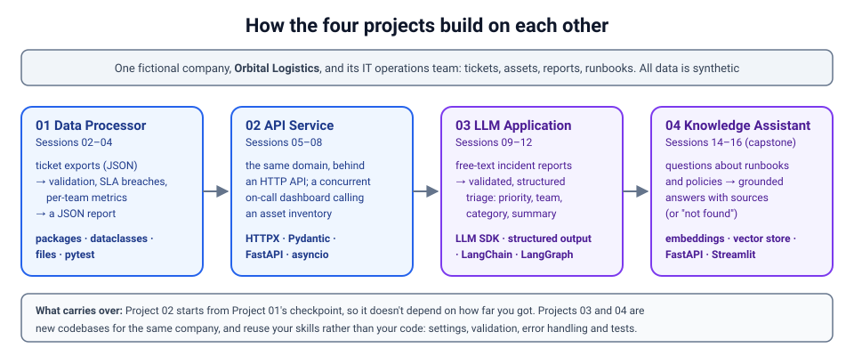

# Python to AI Engineering Bridge

**SkillUp · for experienced developers · 8 weekends · 16 live sessions of 2 hours**

You already build software professionally, in Java, C#, JavaScript or TypeScript, or another language. This course closes the gap between that experience and the Python that AI engineering is written in. By the end, you'll read, write, test and debug professional Python, and build applications that call LLMs, serve APIs and retrieve from your own documents.

It's a bridge, not a complete AI engineering programme: it gives you the Python foundation that AI Engineer, Forward Deployed Engineer and AI Architect programmes assume.

## Who it's for

Developers with several years of experience in another language, who know variables, collections, classes, exceptions, HTTP, JSON and Git, but haven't worked in Python. The course never re-teaches programming. It shows how Python expresses the ideas you know, where it differs, and where it surprises people.

See [`PREREQUISITES.md`](PREREQUISITES.md) for what you need before Session 01, and take the 30-minute [entry diagnostic](assessments/entry-diagnostic.md) to check.

## What you'll be able to do

1. Read and understand Python applications.
2. Create and manage professional Python projects with `uv`.
3. Write idiomatic, maintainable Python, organised into modules and packages.
4. Work with files, JSON, HTTP APIs and external services.
5. Build APIs with FastAPI and Pydantic.
6. Use asynchronous Python for I/O-bound work.
7. Integrate LLM APIs directly, and use selected LangChain and LangGraph abstractions.
8. Build a simple RAG (retrieval-augmented generation) application.
9. Debug, test and explain your code.
10. Use AI coding assistants responsibly, without giving up ownership of your code.

[`LEARNING_OUTCOMES.md`](LEARNING_OUTCOMES.md) lists the measurable outcomes for each session.

## Schedule

| Weekend | Sessions | Theme |
|---:|---|---|
| 1 | 01–02 | Python runtime and setup; language essentials |
| 2 | 03–04 | Functions, files and JSON; packages, classes and testing |
| 3 | 05–06 | HTTP clients; Pydantic |
| 4 | 07–08 | FastAPI; asynchronous Python |
| 5 | 09–10 | Direct LLM integration; LangChain |
| 6 | 11–12 | Retrieval and RAG; LangGraph |
| 7 | 13–14 | AI-assisted engineering; RAG capstone, ingestion |
| 8 | 15–16 | RAG capstone, application; review and readiness |



**How this works**

- The course moves from Python itself (Phase 1), to the kind of applications you'll build professionally (Phase 2), to applications that use LLMs (Phase 3), and finishes with AI-assisted engineering and a capstone (Phase 4).
- Each phase is two weekends: four 2-hour live sessions.
- Each phase ends with a **milestone**: a project that must be complete, with passing tests, before you move on. That's the evidence of what you can do on your own.
- Later sessions assume earlier ones. If you fall behind, catch up on the workbooks first: they're what the projects build on.

Plan for **3 to 5 hours** of independent work between weekends: revising the notebook, the practice quiz, and the workbook assignment. [`COURSE_MAP.md`](COURSE_MAP.md) has the full map of sessions, topics and projects.

## Available sessions

Material is released weekend by weekend. These sessions are available now:

<!-- sessions:start -->
| Session | Topic |
|---|---|
| [00](sessions/session-00/README.md) | Induction — Python to GenAI Engineering |
| [01](sessions/session-01/README.md) | Python Runtime and Professional Setup |
| [02](sessions/session-02/README.md) | Python Language Essentials |
| [03](sessions/session-03/README.md) | Functions, Exceptions, Files and JSON |
| [04](sessions/session-04/README.md) | Modules, Packages, Classes and Testing |
| [05](sessions/session-05/README.md) | HTTP and API Integration |
| [06](sessions/session-06/README.md) | Pydantic and Data Validation |
| [07](sessions/session-07/README.md) | FastAPI |
| [08](sessions/session-08/README.md) | Asynchronous Python |
| [09](sessions/session-09/README.md) | Direct LLM API Integration |
| [10](sessions/session-10/README.md) | LangChain Fundamentals |
| [11](sessions/session-11/README.md) | Retrieval and RAG Fundamentals |
| [12](sessions/session-12/README.md) | Introduction to LangGraph |
| [13](sessions/session-13/README.md) | Claude Code for Professional Engineering |
| [14](sessions/session-14/README.md) | RAG Capstone, Ingestion |
<!-- sessions:end -->

Run `git pull` at the start of each weekend to get the new material.

## Getting started

1. Install the tools: [`docs/getting-started.md`](docs/getting-started.md) walks you through `uv`, Python 3.13, Git and VS Code, step by step.
2. Clone this repository, using the URL from the **Code** button on its GitHub page, and create the course environment:

   ```bash
   git clone <the URL you copied>
   cd python-ai-engineering-bridge
   uv sync
   ```

3. Open the folder in VS Code, start with `sessions/session-00/notebooks/01-concepts.ipynb`, and select the `.venv` kernel.

Prefer `venv` or Conda to `uv`? See [`docs/setup-venv.md`](docs/setup-venv.md) or [`docs/setup-conda.md`](docs/setup-conda.md). The course itself uses `uv` throughout.

## Required tools

| Tool | Version | Why |
|---|---|---|
| [uv](docs/setup-uv.md) | 0.13 or newer | Installs Python, manages project environments and dependencies |
| Python | 3.13 (installed by `uv`) | The language. Every project pins it |
| Git | any recent version | Your projects are Git repositories |
| [VS Code](docs/setup-vscode.md) | recent | Editor, notebooks, debugger. Another editor works if you know it well |
| An LLM API key | optional before Session 09 | OpenAI by default; alternatives in Session 01 Part 8. Every test also runs without one |

## How each session works

Every session folder has the same layout:

| File | Use it for |
|---|---|
| `README.md` | The overview: objectives, time, live-session plan, common mistakes, interview questions |
| `notebooks/01-concepts.ipynb` | The main explanation, with runnable examples. Used live, and for revision |
| `notebooks/02-practice-quiz.ipynb` | A self-check quiz with collapsible answers. Answer before you look |
| `workbook/assignment.md` | The independent assignment: you write real code, in your own project |
| `resources/references.md` | Curated official documentation |

Some sessions add a third notebook, such as a debugging lab.

**Notebooks:** run cells top to bottom. To start again cleanly, use **Restart and Run All**. Notebooks marked as making paid API calls do so only when you opt in; by default they run free. See [`docs/using-jupyter.md`](docs/using-jupyter.md).

**Workbooks:** do the assignments in a folder **outside** this repository, such as `~/skillup`, so that `git pull` never conflicts with your work. Each workbook gives the setup commands, requirements, acceptance criteria, and tests to run. From Session 09, workbooks give requirements rather than step-by-step instructions.

## Projects

The workbooks build four projects about the same fictional company, Orbital Logistics, and its IT operations team. Each project stands on its own, and all data is synthetic.



**How this works**

- Projects 01 and 02 are one codebase in two stages: a command-line report, then the same domain logic behind an HTTP API.
- Project 02 starts from a published **checkpoint** of Project 01, so a hard week on Project 01 doesn't hold you back.
- Projects 03 and 04 are new codebases. They reuse your skills rather than your code: settings, validation, error handling, tests.
- Every project ends with tests you can run, and notes in which you explain your design. That's what the milestones assess.

<!-- release:1 -->
- [**Project 01: Python Data Processor**](projects/01-python-data-processor/README.md) (Sessions 02–04): a command-line report over incident ticket exports, built into a tested package.
<!-- /release:1 -->
<!-- release:3 -->
- [**Project 02: Python API Service**](projects/02-python-api-service/README.md) (Sessions 05–08): the same data behind a FastAPI service, with Pydantic contracts and asynchronous calls to another service.
<!-- /release:3 -->
<!-- release:5 -->
- [**Project 03: LLM-Powered Application**](projects/03-llm-application/README.md) (Sessions 09–12): LLM-assisted triage of free-text incident reports, with validated structured output.
<!-- /release:5 -->
<!-- release:7 -->
- [**Project 04: Internal Knowledge Assistant**](projects/04-rag-capstone/README.md) (Sessions 14–16): the capstone. Retrieval-augmented generation over synthetic IT documentation, with incremental ingestion, answers with sources, a FastAPI service and a simple UI.
<!-- /release:7 -->
<!-- until:7 -->

Project 04, the capstone, is an internal knowledge assistant: retrieval-augmented generation over synthetic company documentation, with a FastAPI service and a simple UI (Sessions 14–16).
<!-- /until:7 -->

Each project has a `starter/` to copy. Where a project continues in a later session, the workbook explains how to add that session's files to your own project.

## Using AI coding assistants

AI coding assistants are part of professional engineering, and Session 13 teaches them properly. Until then, workbooks are marked **Independent**: do them without an AI assistant. You're building the understanding you'll need to judge what an assistant writes. Later assignments are marked **AI-assisted** or **AI-review** where an assistant is expected.

In every case, you're responsible for code you submit: you must be able to explain it, test it and defend it. See [`docs/using-claude-code.md`](docs/using-claude-code.md).

## Checking your work

Each workbook has **acceptance tests** that must pass unchanged, and asks for tests of your own. Self-check quizzes are formative and not graded. Milestone checkpoints follow Sessions 04, 08, 12 and 16, when each project should be complete with tests. The course ends with a practical readiness assessment: building, testing and explaining a small Python application.
<!-- until:8 -->
Details come with the later sessions.
<!-- /until:8 -->
<!-- release:8 -->
See [`assessments/python-readiness.md`](assessments/python-readiness.md) for the readiness standard, [`assessments/final-assessment.md`](assessments/final-assessment.md) for the final assessment, and [`assessments/capstone-rubric.md`](assessments/capstone-rubric.md) for the capstone.
<!-- /release:8 -->

## Reference guides

[`reference/`](reference/README.md) has short guides to look things up in: a Python cheatsheet, a glossary, Python compared with Java, C# and JavaScript, and a uv cheatsheet, joined by guides to each new topic (Pydantic, FastAPI, async, LLM APIs, RAG) as the course reaches it.

## When something doesn't work

- [`docs/troubleshooting.md`](docs/troubleshooting.md): setup and environment problems, with fixes.
- [`docs/debugging-python.md`](docs/debugging-python.md): reading tracebacks and using the debugger.
- [`docs/api-key-security.md`](docs/api-key-security.md): keeping keys safe, and what to do if one leaks.

To check that your copy of the repository is intact, run `uv run python scripts/validate_repository.py` and `uv run python scripts/validate_notebooks.py`.

Found a mistake in the material? See [`CONTRIBUTING.md`](CONTRIBUTING.md).

---

## About the mentor

**Sanjay Negi** brings 23+ years of industry experience and helps experienced software engineers and technology leaders transition into high-value AI roles, including **AI Engineer**, **Forward Deployed Engineer**, and **GenAI Architect**. He has trained more than 1,100 experienced engineers.

<p align="center">
  
</p>

<p align="center">
  <a href="https://www.sanjaynegi.in" target="_blank" rel="noopener noreferrer">Website</a>
  &nbsp;&middot;&nbsp;
  <a href="https://www.linkedin.com/in/sanjay-negi-ai/" target="_blank" rel="noopener noreferrer">LinkedIn</a>
</p>
