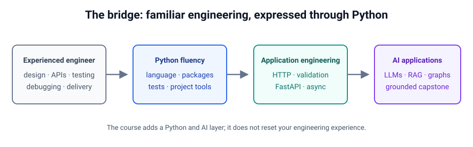

# Session 00: Induction — Python to GenAI Engineering

**Orientation** · Self-study guide · 90–120 minutes · **Not part of the sixteen assessed sessions**

## 1. Session overview

You already know how to design, build and debug software. This course closes a narrower gap: how Python expresses familiar engineering ideas, and how those ideas are used to build reliable AI applications.

This induction previews the complete journey. It explains how language models became large language models, follows text from words to tokens and vectors, compares four ways to run a model, and introduces RAG, agents, agentic RAG, loop engineering and harness engineering. The aim is orientation—not premature mastery. Later sessions implement each important idea properly.

## 2. Why this bridge exists

Experienced Java, C#, JavaScript/TypeScript and automation engineers do not need programming explained from first principles. They need to become productive in Python's ecosystem and conventions:

- read and write idiomatic Python;
- manage reproducible projects with `uv`;
- validate data with Pydantic and expose services with FastAPI;
- use HTTP, asynchronous I/O, tests and structured error handling;
- call LLMs directly before deciding whether a framework helps;
- build and explain a small grounded AI application.

## 3. Learning objectives

After this guide, you should be able to:

1. **Explain** how Transformers, compute and data made modern LLMs practical.
2. **Trace** text through tokenisation, token IDs and embedding vectors.
3. **Compare** base, instruct/chat, reasoning and hybrid models.
4. **Recognise** the engineering layers in REST, SDK and LangChain calls.
5. **Run or adapt** examples for OpenAI, OpenRouter, Ollama and a local Hugging Face model.
6. **Explain** why RAG, agents and agentic RAG exist.
7. **Calculate** cosine similarity and connect it to retrieval.
8. **Distinguish** an agent loop from the harness that constrains it.

## 4. Course roadmap

**How this works**

- Sessions 01–04 translate existing engineering experience into idiomatic Python and tested packages.
- Sessions 05–08 add HTTP clients, validation, FastAPI and asynchronous I/O.
- Sessions 09–12 move from direct LLM APIs to LangChain, retrieval and LangGraph.
- Sessions 14–16 integrate those capabilities into an Internal Knowledge Assistant.
- Session 13 makes AI-assisted development explicit, although responsible assistant use can begin earlier.

## 5. Technologies you will encounter

| Area | Tools and ideas |
|---|---|
| Python engineering | Python 3.13, `uv`, Jupyter, Ruff, pytest |
| Application integration | HTTPX, JSON, environment configuration, `asyncio` |
| Web APIs | Pydantic, FastAPI, OpenAPI |
| Model access | OpenAI, OpenRouter, Ollama, Hugging Face models |
| AI application frameworks | LangChain, LangGraph |
| Retrieval | document loading, chunking, embeddings, vector search |
| Product surface | FastAPI plus Streamlit; Gradio as a lightweight alternative |
| Engineering quality | testing, evaluation, logging, security and human review |

## 6. What you will build

The projects progress from a Python data processor to an API service, then an LLM-powered application, and finally an **Internal Knowledge Assistant**. The capstone ingests Markdown and PDF documents, retrieves relevant passages, generates grounded answers with sources, exposes a FastAPI API, and provides a Streamlit UI.

LangChain will help with selected model and retrieval integrations. It is a tool, not the architecture. Plain Python remains the right choice when the workflow is simple.

## 7. Self-study path

1. Work through [`notebooks/01-concepts.ipynb`](notebooks/01-concepts.ipynb).
2. Run the notebook setup cells. They install into the active local or Google Colab kernel and load provider settings from `.env`.
3. In Colab, upload `.env` through the Files panel. Never place credentials directly in a code cell or commit the file.
4. Run the offline cells first. Network and local-model cells are clearly marked optional.
5. Complete [`notebooks/02-practice-quiz.ipynb`](notebooks/02-practice-quiz.ipynb).
6. Write the short [application design brief](workbook/assignment.md).
7. Keep this guide as a map; use Sessions 09–12 for implementation depth.

## 8. Estimated time

| Activity | Time |
|---|---:|
| Course and GenAI orientation | 60–75 minutes |
| Optional provider experiments | 20–40 minutes |
| Practice quiz | 20 minutes |
| Design brief | 45–60 minutes |

## 9. Common mistakes

| Mistake | Better mental model |
|---|---|
| A token is a word | A token is a model-specific text unit; it may be a word, part of one, punctuation or bytes. |
| A token embedding is the final meaning | It is the first vector representation; Transformer layers make it contextual. |
| RAG teaches the model new facts | RAG supplies selected evidence in the request context; model weights do not change. |
| An agent is any LLM call | An agent repeatedly selects actions or tools using state and feedback. |
| More autonomy is always better | Prefer a deterministic workflow when the path is known. |
| A framework removes provider differences | It reduces boilerplate, but capabilities, errors and semantics still differ. |

## 10. Reflection and interview prompts

1. Which parts of the course are new concepts, and which are familiar engineering expressed through Python?
2. When would you choose local inference over a hosted API?
3. Explain the difference between token embeddings and document embeddings.
4. Why can cosine similarity retrieve a semantically useful but lexically different passage?
5. What belongs inside an agent's loop, and what belongs in its harness?

## 11. Next session

[Session 01](../session-01/README.md) starts with the Python runtime, isolated environments and a reproducible `uv` project.
